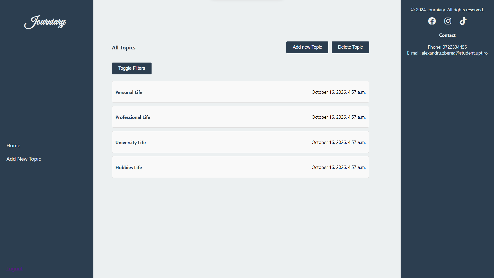

# Emotion Journal

A web application developed as a bachelor's thesis project, designed to help users record their emotions, organize personal journal entries, and visualize emotional patterns through statistics.

## Features

- User registration and authentication
- Personal journal entries
- Organization of entries by topics
- Emotion tracking
- Statistical visualizations
- Editing and deleting journal entries
- 
## Screenshots

### Home Dashboard


### Journal Entry & Emotion Statistics


## Technologies

- **Backend:** Python, Django 4.2.30
- **Frontend:** HTML, CSS, JavaScript
- **Database:** SQLite
- **Data visualization:** Chart.js, Matplotlib

## Getting Started

### 1. Clone the repository

```bash
git clone https://github.com/Azetlex/emotion-journal.git
cd emotion-journal/licenta2
```

### 2. Create a virtual environment

```bash
python -m venv .venv
```

Activate it on Windows:

```cmd
.venv\Scripts\activate
```

### 3. Install dependencies

```bash
python -m pip install -r requirements.txt
```

### 4. Configure the application

Generate a Django secret key by running:

```bash
python -c "from django.core.management.utils import get_random_secret_key; print(get_random_secret_key())"
```

Create a `.env` file in the same folder as `manage.py` and add:

```env
DJANGO_SECRET_KEY=your-generated-key
```

Replace `your-generated-key` with the generated key.

**Important:** Keep `.env` private and never upload it to GitHub.

### 5. Initialize the database

```bash
python manage.py migrate
```

### 6. Run the development server

```bash
python manage.py runserver
```

Open `http://127.0.0.1:8000/` in your browser.

## Project Status

This project is being updated and prepared for public portfolio use. Security improvements, automated tests, and deployment configuration are in progress.

## Background

Originally developed as a bachelor's thesis, this project combines web development with emotion tracking and personal reflection.